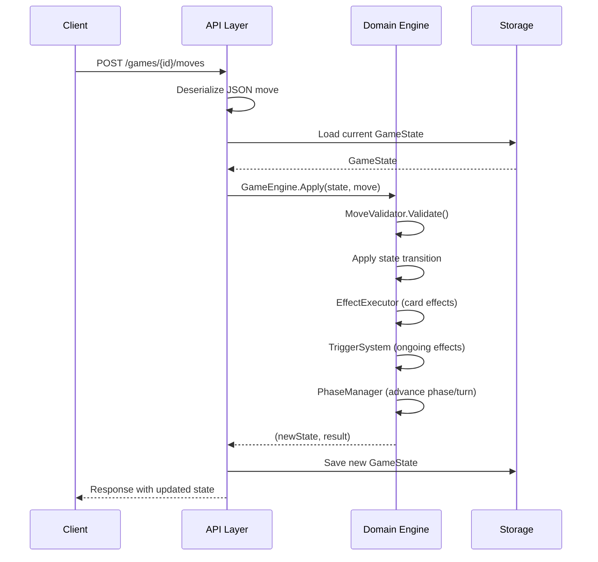
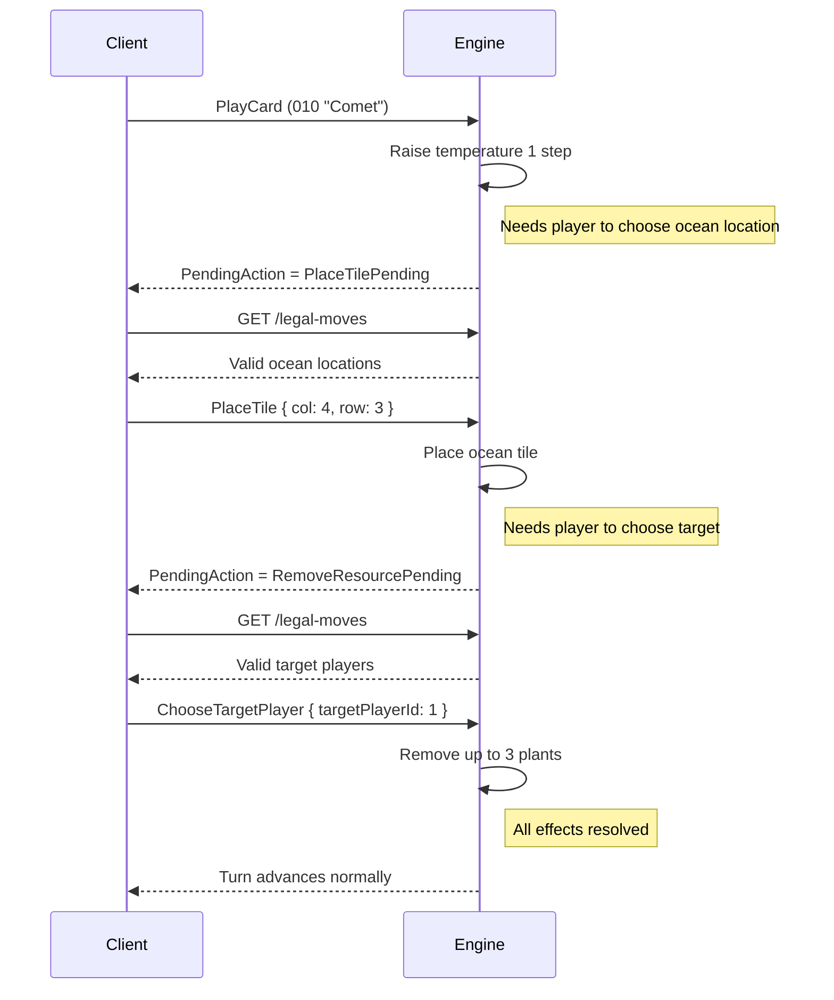

# Terraforming Mars Engine

A stateless, serverless game engine for Terraforming Mars, built with C#/.NET 8.0 and Azure Functions.

Supports the base game, Prelude expansion, and the Hellas, Elysium and Vastitas Borealis maps. Corporate Era and Draft variants are supported.

## Running Locally

```bash
dotnet build
func start --port 7102
```

## Architecture

### How Moves Are Processed

The engine is a pure, deterministic state machine. Game state is an immutable record — every move produces a new state object.



Key properties:
- **Deterministic**: Same state + same move = same result. Games are fully replayable.
- **Immutable**: State is never mutated. Each move produces a new `GameState` record.
- **Stateless API**: The server holds no in-memory state. State is loaded from storage, transformed, and saved back.

### Pending Actions (Sub-Moves)

Some moves trigger effects that need further player input before the turn can continue. These are modeled as **pending actions** on the game state.

Example: playing card "Comet" (010), which raises temperature, places an ocean, and removes plants.



The 12 pending action types cover tile placement, target selection, card selection, option choices, discarding, and effect ordering.

## API

### Create Game

```
POST /games
```

**Request body:**

```json
{
  "playerCount": 2,
  "map": "Tharsis",
  "corporateEra": true,
  "draftVariant": false,
  "preludeExpansion": false,
  "seed": 12345
}
```

All fields except `seed` are required. `map` accepts `"Tharsis"`, `"Hellas"`, `"Elysium"`, or `"Vastitas Borealis"`.

**Response** `201 Created`:

```json
{
  "gameId": "abc-123"
}
```

### Get Game State

```
GET /games/{id}?playerId={playerId}
```

The optional `playerId` query parameter filters the response to that player's perspective. `view=full` shows every player's hand instead (hot-seat play); the draw and discard piles stay hidden. `at={moveNumber}` returns the state after that move rather than the latest one.

**Response** `200 OK`:

```json
{
  "state": { ... },
  "cardNames": { "001": "Card Name", ... }
}
```

### Hot-Seat Table

For one person controlling every seat (the web client's play page). Each response carries everything needed to render the game and offer the next move, so a move is one round trip.

```
GET  /games/{id}/table?at={moveNumber}
POST /games/{id}/table/moves
GET  /games/{id}/history
```

`table` returns the state with all hands visible (the piles stay hidden), plus `players` (each player's score breakdown, tile and tag counts, as in Get Player Status), `legalMoves` (player id → legal moves, only for players who can act), `cardNames`, the pile sizes, `latestMoveNumber`, and `meta` for imported games. With `at`, it returns the position after that move instead, with no legal moves: moves can only be made from the latest position.

`table/moves` takes a move object as in Submit Move (the player is the move's `playerId`) and returns the new table, or `400` with `error` when the move is not legal.

`history` returns the moves played so far as `{ moveNumber, generation, move }`, with the names of all cards.

### Play On From a BGA Replay

A game scraped from Board Game Arena can be played on from any point in generation 2 or later where a player is about to begin an action (`ActionStart`), including the start of each generation's action phase (`GenerationStart`). Positions in the middle of an action, in the research phase, inside a takeback, or after the first pass of the final generation are not offered. The engine state is rebuilt from the game log: counters come from the log's snapshot at that move, hands, tableaux and tiles from the moves up to it. The draw pile is the cards the real game went on to draw, in order, followed by the unseen cards shuffled with `seed` — so replaying the real moves draws the real cards.

```
GET  /import/bga/{tableId}/fork-points
POST /games/import/bga
POST /games/import/bga-log?moveIndex={moveIndex}&seed={seed}
GET  /games/{id}/meta
```

`fork-points` says whether the game can be imported and lists the moves it can be imported after. Every position listed has been built and checked against the log's counters (tags, hand sizes, oceans, pile sizes), so importing it succeeds. Each issue has a `severity` (`Blocking` or `Warning`), a `code` and a `message`.

```json
{
  "eligible": true,
  "forkPoints": [
    { "moveIndex": 105, "moveNumber": 106, "kind": "GenerationStart", "generation": 4, "activeBgaPlayerId": "86296239" }
  ],
  "issues": []
}
```

`games/import/bga` fetches the log by table id from the scraper registry (settings `RegistryApiBase`, and `RegistryApiKey` if the registry needs one). `moveIndex` is a zero-based index into the log's moves and snaps back to the nearest fork point unless `snap` is `false`.

```json
{ "tableId": "824655675", "moveIndex": 117, "seed": 7 }
```

`games/import/bga-log` takes the game log itself as the request body, for local use without the registry. The CLI wraps it: `dotnet run --project TmEngine.Cli -- import-bga <logFile> <moveIndex> [seed]`.

**Response** `201 Created`, or `422` with `issues` when the position cannot be imported:

```json
{
  "gameId": "abc-123",
  "fork": { "moveIndex": 105, "moveNumber": 106, "kind": "GenerationStart", "generation": 4, "activeBgaPlayerId": "86296239" },
  "meta": {
    "seats": [ { "seat": 0, "bgaPlayerId": "98490496", "name": "cdman234", "color": "#ff0000" }, ... ],
    "source": { "tableId": "824655675", "perspective": "86296239", "moveIndex": 105, "moveNumber": 106 },
    "shuffleSeed": 7
  },
  "issues": []
}
```

Engine player ids are seats `0..n-1` in turn order; `meta` (also at `GET /games/{id}/meta`) maps them back to the BGA players.

Not importable: games with more than two players (turn order and drafting have only been verified for two); maps other than Tharsis, Hellas, Elysium and Vastitas Borealis; Colonies; logs from old scraper versions (no hands or pile counts); tables played without live scoring (terraform ratings are not recorded); and positions where the log's counters contradict the cards found in it.

### Get Legal Moves

```
GET /games/{id}/legal-moves?playerId={playerId}
```

Returns all moves currently available to the specified player.

**Response** `200 OK`:

```json
{
  "moves": { ... },
  "cardNames": { "001": "Card Name", ... }
}
```

### Submit Move

```
POST /games/{id}/moves?playerId={playerId}
```

Submits a move for the specified player. The request body contains the move object.

**Response** `200 OK`:

```json
{
  "success": true,
  "state": { ... },
  "cardNames": { "001": "Card Name", ... }
}
```

### Get Cards

```
GET /cards
GET /cards?gameId={id}
```

Returns card metadata keyed by card ID. Without `gameId`, returns the full card catalog; with `gameId`, returns only cards referenced by that game. Each entry includes `id`, `name`, `type`, `cost`, `tags`, `requirements`, and `description`.

### Get Player Status

```
GET /games/{id}/status
```

Returns the full per-player score breakdown (TR, card VP, milestones, awards, greenery and city VP), tile counts, current resources, production, and tag counts.

**Response** `200 OK`:

```json
{
  "players": [
    {
      "playerId": 0,
      "corporation": "Tharsis Republic",
      "points": { "total": 62, "tr": 28, "vp": 12, "milestones": 5, "awards": 5, "greeneries": 7, "cities": 5 },
      "tiles": { "greeneries": 7, "cities": 3, "special": 0 },
      "resources": { ... },
      "production": { ... },
      "tags": { "building": 4, "space": 2, ... }
    }
  ]
}
```

## Move Commands

Moves are submitted as JSON to `POST /games/{id}/moves?playerId={playerId}`. Every move has a `type` discriminator and `playerId`. Property names are camelCase.

**Paying with heat (Helion).** Moves whose cost in MC comes without a `payment` — standard projects, claiming a milestone, funding an award, buying cards, card actions that cost MC, and a placement on the Hellas South Pole — take an optional `heat`: how much of the cost to pay with heat, MC covering the rest.

```json
{ "type": "Asteroid", "playerId": 0, "heat": 6 }
```

It is rejected unless the player may pay with heat, holds that much, the amount is no more than the cost, and their MC covers the remainder. Left out, MC is spent first and heat only covers a shortfall. Moves with a `payment` (playing a card, actions payable with steel or titanium) put heat in the payment instead.

### Setup Phase

**Setup** — Choose corporation, preludes, and starting cards:

```json
{
  "type": "Setup",
  "playerId": 0,
  "corporationId": "CORP02",
  "preludeIds": ["P01", "P07"],
  "cardIdsToBuy": ["047", "048"]
}
```

### Research Phase

**DraftCard** — Draft one card (Draft variant only):

```json
{ "type": "DraftCard", "playerId": 0, "cardId": "047" }
```

**BuyCards** — Buy cards from dealt/drafted selection (3 MC each):

```json
{ "type": "BuyCards", "playerId": 0, "cardIds": ["047", "048"] }
```

### Action Phase

**PlayCard** — Play a project card from hand:

```json
{
  "type": "PlayCard",
  "playerId": 0,
  "cardId": "047",
  "payment": { "megaCredits": 10, "steel": 0, "titanium": 0, "heat": 0 }
}
```

**SellPatents** — Sell cards from hand for 1 MC each:

```json
{ "type": "SellPatents", "playerId": 0, "cardIds": ["047", "048"] }
```

**PowerPlant** — Pay to increase energy production 1 step:

```json
{ "type": "PowerPlant", "playerId": 0 }
```

**Asteroid** — Pay to raise temperature 1 step:

```json
{ "type": "Asteroid", "playerId": 0 }
```

**Aquifer** — Pay to place an ocean tile:

```json
{ "type": "Aquifer", "playerId": 0, "location": { "col": 4, "row": 3 } }
```

**Greenery** — Pay to place a greenery tile and raise oxygen:

```json
{ "type": "Greenery", "playerId": 0, "location": { "col": 4, "row": 3 } }
```

**City** — Pay to place a city tile and increase MC production:

```json
{ "type": "City", "playerId": 0, "location": { "col": 5, "row": 3 } }
```

**UseCardAction** — Use a blue card's action:

```json
{ "type": "UseCardAction", "playerId": 0, "cardId": "033" }
```

**ClaimMilestone**:

```json
{ "type": "ClaimMilestone", "playerId": 0, "milestoneName": "Terraformer" }
```

**FundAward**:

```json
{ "type": "FundAward", "playerId": 0, "awardName": "Landlord" }
```

**ConvertPlants** — Convert 8 plants to a greenery tile:

```json
{ "type": "ConvertPlants", "playerId": 0, "location": { "col": 4, "row": 3 } }
```

**ConvertHeat** — Convert 8 heat to raise temperature:

```json
{ "type": "ConvertHeat", "playerId": 0 }
```

**Pass** — Pass for the rest of the generation:

```json
{ "type": "Pass", "playerId": 0 }
```

**EndTurn** — Skip remaining action(s) this turn without passing for the generation:

```json
{ "type": "EndTurn", "playerId": 0 }
```

**PerformFirstAction** — Perform corporation's mandatory first action (generation 1 only):

```json
{ "type": "PerformFirstAction", "playerId": 0 }
```

### Prelude Phase

**PlayPrelude** — Play a prelude card:

```json
{ "type": "PlayPrelude", "playerId": 0, "preludeId": "P01" }
```

### Sub-Moves

Some moves trigger pending actions that require follow-up sub-moves before play continues. The game state's pending action indicates which sub-move is needed.

**PlaceTile** — Place a tile at a board location:

```json
{ "type": "PlaceTile", "playerId": 0, "location": { "col": 4, "row": 3 } }
```

**ChooseTargetPlayer** — Select a target player (e.g. for resource removal):

```json
{ "type": "ChooseTargetPlayer", "playerId": 0, "targetPlayerId": 1 }
```

**SelectCard** — Select a card (e.g. for adding resources):

```json
{ "type": "SelectCard", "playerId": 0, "cardId": "052" }
```

**ChooseOption** — Choose from a list of options by index:

```json
{ "type": "ChooseOption", "playerId": 0, "optionIndex": 0 }
```

**DiscardCards** — Discard specific cards:

```json
{ "type": "DiscardCards", "playerId": 0, "cardIds": ["047"] }
```

**ChooseEffectOrder** — Choose which triggered effect to resolve next (use -1 to auto-execute all remaining):

```json
{ "type": "ChooseEffectOrder", "playerId": 0, "effectIndex": 0 }
```

### Error Responses

All endpoints may return `400 Bad Request`, `404 Not Found`, or `409 Conflict` with:

```json
{
  "error": "Description of what went wrong"
}
```
